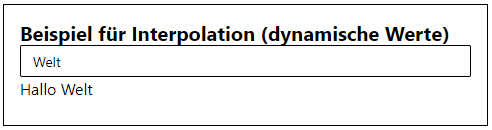
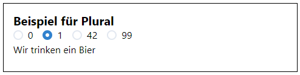
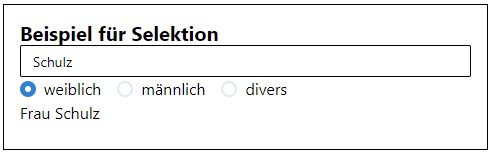
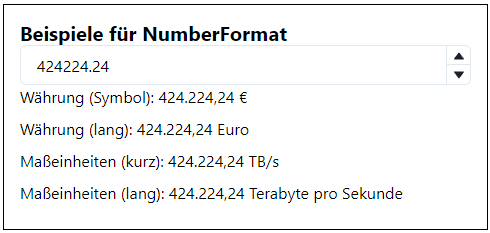
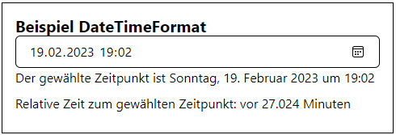
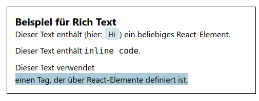

To show how we can use I18n in our Open Pioneer Trails apps, we will extend the empty app (at `src/apps/empty`).

By default, the empty app is prepared to support I18n with locale `en`.
We will add support for another language (locale `de`) and demonstrate advanced features of [FormatJS](https://formatjs.io/) Intl.

> **Note**  
> For details about the i18n file format, see [I18nFormat](../reference/I18nFormat.md).

## Preparing i18n support for our app

To begin, start the development server:

```bash
pnpm run dev
```

Then open the [empty app](http://localhost:5173/sites/empty/).

Open the `build.config.mjs` and add locale `de` to the `i18n` property:

```js
// src/apps/empty/build.config.mjs
import { defineBuildConfig } from "@open-pioneer/build-support";

export default defineBuildConfig({
    i18n: ["de", "en"]
});
```

We will see an error message in the browser, because of the missing YAML file for our new locale.
We need to create the file in the `i18n` folder. The naming schema of the file is `{locale}.yaml`.

```yaml
# src/apps/empty/i18n/de.yaml
messages:
    heading: "I18n HowTo"
    text: "Wie lässt sich I18n in Open Pioneer Trails Apps nutzen?"
```

By default, the app uses the browser settings or system default for determining the locale.
If your browser locale is set to `de` you should see the values from `de.yaml` (maybe you will need to restart the dev server).


To demonstrate the multi-language support and force a language of our choice, we need to modify the `app.ts`:

```ts
// src/apps/empty/app.ts
import { createCustomElement } from "@open-pioneer/runtime";
import * as appMetadata from "open-pioneer:app";
import { AppUI } from "./AppUI";

// Reads the 'lang' parameter from the URL and, if set, uses it
// for the application's locale.
// This can be helpful during development, but it is entirely optional.
const URL_PARAMS = new URLSearchParams(window.location.search);
const FORCED_LANG = URL_PARAMS.get("lang") || undefined;

const Element = createCustomElement({
    component: AppUI,
    appMetadata,
    config: {
        // Forces the locale if set to a string.
        // 'undefined' chooses an automatic locale based on the app and
        // the user's preferred languages.
        locale: FORCED_LANG
    }
});
customElements.define("empty-app", Element);
```

Now we are able to force the locale with `lang` parameter:
[http://localhost:5173/sites/empty/?lang=de](http://localhost:5173/sites/empty/?lang=de) or [http://localhost:5173/sites/empty/?lang=en](http://localhost:5173/sites/empty/?lang=en)

The value must match one of the locales listed in `i18n`.
Otherwise, the app shows an error screen instead of its UI.

> **Note**
> The integration of I18n works the same way for Trails packages. We have to add the `i18n` configuration in `build.config.mjs` and matching yaml files for each language in the `i18n` folder. For each app/language combination, the build tool collects the YAML files of the app and the used packages and merges them into a flattened JSON structure.
> As mentioned in [I18nFormat](../reference/I18nFormat.md) we can override yaml entries from packages in our app yaml. Please check the [`i18n-sample`](https://github.com/open-pioneer/trails-core-packages/tree/main/src/samples/i18n-sample) app as a practical example for this topic.

## Using advanced features of FormatJS Intl

The examples in this section use components from `@open-pioneer/chakra-snippets` and types from `@conterra/reactivity-core`.
Add both packages to the dependencies of the empty app and run `pnpm install`:

```jsonc
// src/apps/empty/package.json
{
    // ...
    "dependencies": {
        // ...
        "@conterra/reactivity-core": "catalog:",
        "@open-pioneer/chakra-snippets": "catalog:"
    }
}
```

The code snippets below only show the components.
They require the following imports at the top of the file:

```tsx
// src/apps/empty/AppUI.tsx
import {
    Box,
    Button,
    Container,
    Heading,
    HStack,
    Input,
    Stack,
    StackSeparator,
    Tag,
    Text,
    VStack
} from "@chakra-ui/react";
import { NumberInputField, NumberInputRoot } from "@open-pioneer/chakra-snippets/number-input";
import { Radio, RadioGroup } from "@open-pioneer/chakra-snippets/radio";
import { useIntl, useService } from "open-pioneer:react-hooks";
import { useState } from "react";
```

In a first step we prepare our AppUI:

```tsx
// src/apps/empty/AppUI.tsx
export function AppUI() {
    const intl = useIntl();
    return (
        <Container>
            <Heading as="h1" size="lg">
                {intl.formatMessage({ id: "heading" })}
            </Heading>
            <Text>{intl.formatMessage({ id: "text" })}</Text>
            <ExampleStack></ExampleStack>
        </Container>
    );
}
```

We initialize the `intl` object with the `useIntl` hook. Now we can use `intl.formatMessage` with our flattened keys from the yaml files to add our translated text to the app.
In addition, we define the `ExampleStack` as a container for our advanced examples.

### Interpolation

First we generate an entry in our `ExampleStack` for our `InterpolationExample`:

```tsx
// src/apps/empty/AppUI.tsx
function ExampleStack() {
    return (
        <Stack
            mb={5}
            mt={5}
            separator={<StackSeparator borderColor="gray.200" />}
            gap="24px"
            align="stretch"
        >
            <Box bg="white" w="100%" p={4} color="black" borderWidth="1px" borderColor="black">
                <InterpolationExample></InterpolationExample>
            </Box>
        </Stack>
    );
}
```

Interpolation allows replacement with dynamic values. That's why we use a text input field in our interpolation example:

```tsx
// src/apps/empty/AppUI.tsx
function InterpolationExample() {
    const intl = useIntl();
    const [value, setValue] = useState("");
    return (
        <>
            <Heading as="h4" size="md">
                {intl.formatMessage({ id: "interpolation.heading" })}
            </Heading>
            <Input
                value={value}
                onChange={(evt) => setValue(evt.target.value)}
                placeholder={intl.formatMessage({ id: "interpolation.placeholder" })}
                size="sm"
            />
            <Text mb="8px">
                {intl.formatMessage({ id: "interpolation.value" }, { name: value })}
            </Text>
        </>
    );
}
```

As we can see, the bound input value `value` is passed to the `intl.formatMessage` function with the parameter name `name`.
Add the keys and values to the yaml configuration:

```yaml
# src/apps/empty/i18n/de.yaml
messages:
    #....
    interpolation:
        heading: "Beispiel für Interpolation (dynamische Werte)"
        value: "Hallo {name}"
        placeholder: "Geben Sie Ihren Namen ein..."
#....
```

Add the defined keys to all yaml files.

The `interpolation.value` key uses a placeholder for `name`.
In the rendered text the passed value of `name` will replace the placeholder.



### Plurals

We generate another entry in our `ExampleStack` for our `PluralsExample`:

```tsx
// src/apps/empty/AppUI.tsx
function ExampleStack() {
    return (
        <Stack
            mb={5}
            mt={5}
            separator={<StackSeparator borderColor="gray.200" />}
            gap="24px"
            align="stretch"
        >
            <Box bg="white" w="100%" p={4} color="black" borderWidth="1px" borderColor="black">
                <InterpolationExample></InterpolationExample>
            </Box>
            <Box bg="white" w="100%" p={4} color="black" borderWidth="1px" borderColor="black">
                <PluralsExample></PluralsExample>
            </Box>
        </Stack>
    );
}
```

With plural support we can output different text depending on a count value (see [plural format](https://formatjs.github.io/docs/core-concepts/icu-syntax/#plural-format)).
We will use a RadioGroup to change the count value in our example:

```tsx
// src/apps/empty/AppUI.tsx
function PluralsExample() {
    const intl = useIntl();
    const [value, setValue] = useState<string | null>("1");
    return (
        <>
            <Heading as="h4" size="md">
                {intl.formatMessage({ id: "plurals.heading" })}
            </Heading>
            <RadioGroup onValueChange={(e) => setValue(e.value)} value={value}>
                <Stack gap={4} direction="row">
                    <Radio value="0">0</Radio>
                    <Radio value="1">1</Radio>
                    <Radio value="42">42</Radio>
                    <Radio value="99">99</Radio>
                </Stack>
            </RadioGroup>
            <Text mb="8px">{intl.formatMessage({ id: "plurals.value" }, { n: value })}</Text>
        </>
    );
}
```

The bound value `value` is passed to the `intl.formatMessage` function with the parameter name `n`. Here is the yaml configuration:

```yaml
# src/apps/empty/i18n/de.yaml
messages:
    #....
    plurals:
        heading: "Beispiel für Plural"
        value: "Wir trinken {n, plural, =0 {kein Bier} one {ein Bier} other {# Biere} =99 {zu viel Bier}}"
#....
```

Add the defined keys to all yaml files.

The `plurals.value` key defines a count parameter `n`. As a result, the passed value of `n` will be used to generate the matching output.



### Selection

Let's add an entry for `SelectionExample` in our `ExampleStack`:

```tsx
// src/apps/empty/AppUI.tsx
function ExampleStack() {
    return (
        <Stack
            mb={5}
            mt={5}
            separator={<StackSeparator borderColor="gray.200" />}
            gap="24px"
            align="stretch"
        >
            <Box bg="white" w="100%" p={4} color="black" borderWidth="1px" borderColor="black">
                <InterpolationExample></InterpolationExample>
            </Box>
            <Box bg="white" w="100%" p={4} color="black" borderWidth="1px" borderColor="black">
                <PluralsExample></PluralsExample>
            </Box>
            <Box bg="white" w="100%" p={4} color="black" borderWidth="1px" borderColor="black">
                <SelectionExample></SelectionExample>
            </Box>
        </Stack>
    );
}
```

With selection support we can output different text depending on a set of given values (see [select format](https://formatjs.github.io/docs/core-concepts/icu-syntax/#select-format)).
In our example we will change the title depending on a gender selection.
We will use a text input for name and a RadioGroup for gender selection:

```tsx
// src/apps/empty/AppUI.tsx
function SelectionExample() {
    const intl = useIntl();
    const [value1, setValue1] = useState("");
    const [value2, setValue2] = useState<string | null>("male");
    return (
        <>
            <Heading as="h4" size="md">
                {intl.formatMessage({ id: "selection.heading" })}
            </Heading>
            <Input
                value={value1}
                onChange={(evt) => setValue1(evt.target.value)}
                placeholder={intl.formatMessage({ id: "interpolation.placeholder" })}
                size="sm"
            />
            <RadioGroup onValueChange={(e) => setValue2(e.value)} value={value2}>
                <Stack gap={4} direction="row">
                    <Radio value="female">
                        {intl.formatMessage({ id: "selection.gender.female" })}
                    </Radio>
                    <Radio value="male">
                        {intl.formatMessage({ id: "selection.gender.male" })}
                    </Radio>
                    <Radio value="other">
                        {intl.formatMessage({ id: "selection.gender.other" })}
                    </Radio>
                </Stack>
            </RadioGroup>
            <Text mb="8px">
                {intl.formatMessage({ id: "selection.value" }, { name: value1, gender: value2 })}
            </Text>
        </>
    );
}
```

We pass the name (`value1`) and gender (`value2`) to the `intl.formatMessage`.
Here is the yaml configuration:

```yaml
# src/apps/empty/i18n/de.yaml
messages:
    #....
    selection:
        heading: "Beispiel für Selektion"
        value: "{gender, select, male {Herr} female {Frau} other {}} {name}"
        gender:
            male: "männlich"
            female: "weiblich"
            other: "divers"
#....
```

Add the defined keys to all `yaml` files.

The `selection.value` key defines a parameter `gender` for selection and uses the dynamic parameter `name`.
In a selection we always have to define the `other` case.
It is used if the given parameter value does not match one of the other values (e.g. `male` or `female`).
As a result, the passed value of `gender` and `name` will be used to generate the matching output.



### Number Format

Now we add an entry for `NumberFormatExample` to our `ExampleStack`:

```tsx
// src/apps/empty/AppUI.tsx
function ExampleStack() {
    return (
        <Stack
            mb={5}
            mt={5}
            separator={<StackSeparator borderColor="gray.200" />}
            gap="24px"
            align="stretch"
        >
            <Box bg="white" w="100%" p={4} color="black" borderWidth="1px" borderColor="black">
                <InterpolationExample></InterpolationExample>
            </Box>
            <Box bg="white" w="100%" p={4} color="black" borderWidth="1px" borderColor="black">
                <PluralsExample></PluralsExample>
            </Box>
            <Box bg="white" w="100%" p={4} color="black" borderWidth="1px" borderColor="black">
                <SelectionExample></SelectionExample>
            </Box>
            <Box bg="white" w="100%" p={4} color="black" borderWidth="1px" borderColor="black">
                <NumberFormatExample></NumberFormatExample>
            </Box>
        </Stack>
    );
}
```

With `formatNumber` we can not only format numbers for the current locale, but also use units and currencies (see [`formatNumber`](https://formatjs.github.io/docs/react-intl/api/#formatnumber)).
In our example we will have a number input and an output with different forms of unit and currency:

```tsx
// src/apps/empty/AppUI.tsx
function NumberFormatExample() {
    const intl = useIntl();
    const [value, setValue] = useState("424224.24");
    const [numericValue, setNumericValue] = useState(424224.24);
    return (
        <>
            <Heading as="h4" size="md">
                {intl.formatMessage({ id: "numberformat.heading" })}
            </Heading>
            <NumberInputRoot
                onValueChange={({ value, valueAsNumber }) => {
                    // See https://chakra-ui.com/docs/components/number-input#why-use-string-values
                    setValue(value);
                    setNumericValue(valueAsNumber);
                }}
                value={value}
                step={0.25}
                formatOptions={{
                    minimumFractionDigits: 2,
                    maximumFractionDigits: 2,
                    useGrouping: false
                }}
            >
                <NumberInputField />
            </NumberInputRoot>
            <Text mb="8px">
                {intl.formatMessage({ id: "numberformat.example.currency1" })}
                {intl.formatNumber(numericValue, { style: "currency", currency: "EUR" })}
            </Text>
            <Text mb="8px">
                {intl.formatMessage({ id: "numberformat.example.currency2" })}
                {intl.formatNumber(numericValue, {
                    style: "currency",
                    currency: "EUR",
                    currencyDisplay: "name"
                })}
            </Text>
            <Text mb="8px">
                {intl.formatMessage({ id: "numberformat.example.unit1" })}
                {intl.formatNumber(numericValue, { style: "unit", unit: "terabyte-per-second" })}
            </Text>
            <Text mb="8px">
                {intl.formatMessage({ id: "numberformat.example.unit2" })}
                {intl.formatNumber(numericValue, {
                    style: "unit",
                    unit: "terabyte-per-second",
                    unitDisplay: "long"
                })}
            </Text>
        </>
    );
}
```

Here is the yaml configuration:

```yaml
# src/apps/empty/i18n/de.yaml
messages:
    #....
    numberformat:
        heading: "Beispiele für NumberFormat"
        example:
            currency1: "Währung (Symbol): "
            currency2: "Währung (lang): "
            unit1: "Maßeinheiten (kurz): "
            unit2: "Maßeinheiten (lang): "
#....
```

Add the defined keys to all yaml files.

The number input reports its value both as a string and as a number.
We pass the numeric value with different `NumberFormatOptions` to `intl.formatNumber`.
As a result, we see our formatted numbers.



### Date/Time Format and Relative Time Format

Finally, we add an entry for the `DateTimeFormatExample` to our `ExampleStack`:

```tsx
// src/apps/empty/AppUI.tsx
function ExampleStack() {
    return (
        <Stack
            mb={5}
            mt={5}
            separator={<StackSeparator borderColor="gray.200" />}
            gap="24px"
            align="stretch"
        >
            <Box bg="white" w="100%" p={4} color="black" borderWidth="1px" borderColor="black">
                <InterpolationExample></InterpolationExample>
            </Box>
            <Box bg="white" w="100%" p={4} color="black" borderWidth="1px" borderColor="black">
                <PluralsExample></PluralsExample>
            </Box>
            <Box bg="white" w="100%" p={4} color="black" borderWidth="1px" borderColor="black">
                <SelectionExample></SelectionExample>
            </Box>
            <Box bg="white" w="100%" p={4} color="black" borderWidth="1px" borderColor="black">
                <NumberFormatExample></NumberFormatExample>
            </Box>
            <Box bg="white" w="100%" p={4} color="black" borderWidth="1px" borderColor="black">
                <DateTimeFormatExample></DateTimeFormatExample>
            </Box>
        </Stack>
    );
}
```

In our example we will have a date time input:

```tsx
// src/apps/empty/AppUI.tsx
function DateTimeFormatExample() {
    const intl = useIntl();
    const [value, setValue] = useState("2023-02-19T19:02");
    return (
        <>
            <Heading as="h4" size="md">
                {intl.formatMessage({ id: "datetimeformat.heading" })}
            </Heading>
            <Input
                value={value}
                onChange={(evt) => setValue(evt.target.value)}
                size="md"
                type="datetime-local"
            />
            <Text mb="8px">
                {intl.formatMessage({ id: "datetimeformat.timelabel" })}
                {intl.formatDate(value, { dateStyle: "full", timeStyle: "short" })}
            </Text>
            <Text mb="8px">
                {intl.formatMessage({ id: "datetimeformat.relativetimelabel" })}
                {intl.formatRelativeTime(getDeltaTime(value), "minute", {
                    numeric: "auto",
                    style: "long"
                })}
            </Text>
        </>
    );
}
```

To calculate the delta for our relative time output we define the function `getDeltaTime`:

```ts
function getDeltaTime(datetime: string): number {
    const delta = new Date(datetime).getTime() - new Date().getTime();
    return Math.round(delta / 60000);
}
```

Here is the yaml configuration:

```yaml
# src/apps/empty/i18n/de.yaml
messages:
    #....
    datetimeformat:
        heading: "Beispiel DateTimeFormat"
        timelabel: "Der gewählte Zeitpunkt ist "
        relativetimelabel: "Relative Zeit zum gewählten Zeitpunkt: "
#....
```

Add the defined keys to all yaml files.

We pass the `value` with `DateTimeFormatOptions` to `intl.formatDate` (see [`formatDate`](https://formatjs.github.io/docs/react-intl/api/#formatdate))
and with `RelativeTimeFormatOptions` to `intl.formatRelativeTime` (see [`formatRelativeTime`](https://formatjs.github.io/docs/react-intl/api/#formatrelativetime))

As a result, we see our selected formatted datetime and the relative time between now and the selected datetime.



> **Note**  
> The used datetime input does not support a forced locale.
> It always uses the defined browser locale or the system default. In our example, if your browser uses locale `de`
> but your app uses URL parameter `lang=en` the input will show values for locale `de`.

### Formatting rich text

So far, we have used the `intl.formatMessage` method to format _strings_.
Using this function, _primitive values_ (such as strings, numbers, etc.) can be used as values in placeholders such as `{name}`.
For rich user interfaces, this way of rendering messages can be limiting in practice.

To render _rich_ text with _React_ components for your user interface, use `intl.formatRichMessage()` instead.
This function follows the same principles as `intl.formatMessage()`, but is different in a few key ways:

- It always returns a React node. It can therefore only be used in combination with React components.
- It supports React nodes as _values_. You can still use placeholders in your messages (like `{name}`) but you can substitute arbitrary React nodes instead of only primitive values.
- It supports defining custom tags in terms of React nodes, using functions as _values_.
- It provides a few basic formatting tags out of the box.

**Examples:**

Our messages look similar to the earlier examples:

```yaml
# src/apps/empty/i18n/de.yaml
messages:
    # ...
    richtext:
        heading: "Beispiel für Rich Text"
        messageWithReactNode: "Dieser Text enthält (hier: {element}) ein beliebiges React-Element."
        messageWithInlineCode: "Dieser Text enthält <code>inline code</code>."
        messageWithReactTag: "Dieser Text verwendet <customTag>einen Tag, der über React-Elemente definiert ist.</customTag>"
```

It is the rendering part that differs:

```tsx
// src/apps/empty/AppUI.tsx
function RichTextExample() {
    const intl = useIntl();

    return (
        <>
            <Heading as="h4" size="md">
                {intl.formatMessage({ id: "richtext.heading" })}
            </Heading>
            <VStack gap={2} align="start">
                <Box>
                    {intl.formatRichMessage(
                        { id: "richtext.messageWithReactNode" },
                        {
                            element: (
                                <Tag.Root>
                                    <Tag.Label>Hi</Tag.Label>
                                </Tag.Root>
                            )
                        }
                    )}
                </Box>
                <Box>
                    {intl.formatRichMessage({
                        id: "richtext.messageWithInlineCode"
                    })}
                </Box>
                <Box>
                    {intl.formatRichMessage(
                        {
                            id: "richtext.messageWithReactTag"
                        },
                        {
                            customTag: (parts) => (
                                <Box display="inline-block" background="trails.200" px={1}>
                                    {parts}
                                </Box>
                            )
                        }
                    )}
                </Box>
            </VStack>
        </>
    );
}
```

Add an entry for the `RichTextExample` to the `ExampleStack`, as for the previous examples:

```tsx
// src/apps/empty/AppUI.tsx
function ExampleStack() {
    return (
        <Stack /* ... */>
            {/* ... */}
            <Box bg="white" w="100%" p={4} color="black" borderWidth="1px" borderColor="black">
                <RichTextExample></RichTextExample>
            </Box>
        </Stack>
    );
}
```

The example is rendered like this:



### Using i18n in a service

The `intl` object is not only available in React components, it can also be used from any service.
The `GreetingService` in the following example uses the `serviceOptions` parameter (provided by the framework) to access the package's `intl` object via `currentIntl`.
This object can be used in the same way as the `intl` object returned by `useIntl`:

```ts
// src/apps/empty/GreetingService.ts
import { ReadonlyReactive } from "@conterra/reactivity-core";
import { type DECLARE_SERVICE_INTERFACE, ServiceOptions, PackageIntl } from "@open-pioneer/runtime";

export class GreetingService {
    declare [DECLARE_SERVICE_INTERFACE]: "empty.GreetingService";

    private readonly _intl: ReadonlyReactive<PackageIntl>;

    constructor(serviceOptions: ServiceOptions) {
        this._intl = serviceOptions.currentIntl;
    }

    // (1)
    greet(name: string): string {
        return this._intl.value.formatMessage({ id: "greetingService.greeting" }, { name });
    }
}
```

Our goal is to implement a UI component that calls the `greet()` (see **(1)**) method from above.
To make the service usable from the UI, we have to perform some necessary plumbing:

```ts
// src/apps/empty/services.ts
export { GreetingService } from "./GreetingService";
```

```js
// src/apps/empty/build.config.mjs
import { defineBuildConfig } from "@open-pioneer/build-support";

export default defineBuildConfig({
    i18n: ["de", "en"],
    services: {
        GreetingService: {
            provides: ["empty.GreetingService"]
        }
    },
    ui: {
        references: ["empty.GreetingService"]
    }
});
```

Here is the yaml configuration:

```yaml
# src/apps/empty/i18n/de.yaml
messages:
    #....
    serviceI18n:
        heading: "Beispiel für Service I18n"
        placeholder: "Namen eintragen"
        showGreeting: "Nachricht anzeigen"
        serviceResponse: "Nachricht: "
    greetingService:
        greeting: Hallo {name}!
#....
```

The `ServiceI18nExample` component displays a simple React form using the `intl` API you have already seen.
In addition to using i18n from within the React component, it also interacts with a service (`GreetingService`, **(1)** in the example below) to show a translated message.
The form asks the user for a name and then calls the `greetingService.greet(name)` method (see **(2)** below) to show a greeting:

```tsx
// src/apps/empty/AppUI.tsx
function ServiceI18nExample() {
    const intl = useIntl();
    const greetingService = useService<GreetingService>("empty.GreetingService"); // (1)
    const [inputValue, setInputValue] = useState("");
    const [greeting, setGreeting] = useState("");
    return (
        <>
            <Heading as="h4" size="md">
                {intl.formatMessage({ id: "serviceI18n.heading" })}
            </Heading>
            <HStack
                as="form"
                onSubmit={(e) => {
                    e.preventDefault();

                    const name = inputValue.trim();
                    if (name) {
                        setGreeting(greetingService.greet(name)); // (2)
                    } else {
                        setGreeting("");
                    }
                }}
            >
                <Input
                    placeholder={intl.formatMessage({ id: "serviceI18n.placeholder" })}
                    value={inputValue}
                    onChange={(evt) => setInputValue(evt.target.value)}
                    size="md"
                />
                <Button type="submit" flexShrink={0}>
                    {intl.formatMessage({ id: "serviceI18n.showGreeting" })}
                </Button>
            </HStack>
            {greeting && (
                <Text>
                    {intl.formatMessage({ id: "serviceI18n.serviceResponse" })} {greeting}
                </Text>
            )}
        </>
    );
}
```

The component uses the type of the service, so add the following import to `AppUI.tsx`:

```tsx
// src/apps/empty/AppUI.tsx
import { GreetingService } from "./GreetingService";
```

Finally, add an entry for the `ServiceI18nExample` to the `ExampleStack`:

```tsx
// src/apps/empty/AppUI.tsx
function ExampleStack() {
    return (
        <Stack /* ... */>
            {/* ... */}
            <Box bg="white" w="100%" p={4} color="black" borderWidth="1px" borderColor="black">
                <ServiceI18nExample></ServiceI18nExample>
            </Box>
        </Stack>
    );
}
```

## Demo App

The complete app `i18n-howto` can be found in the `samples` folder.

## Changing the application's locale

The application's locale can be changed at runtime with the `LocaleService` (interface `"runtime.LocaleService"`) from the `@open-pioneer/runtime` package.

Example:

```ts
import { LocaleService } from "@open-pioneer/runtime";

const localeService: LocaleService = ...; // injected
await localeService.changeLocale(new Intl.Locale("en-US"));
```

The locale must match one of the locales supported by the application (see `localeService.supportedMessageLocales`).
It does not need to be a precise match: `en-US` is valid if `en` is supported.
Use `undefined` to switch back to the default locale.
The returned promise rejects if the locale is not supported.

> NOTE: The methods `getLocale()`, `setLocale()` and `getSupportedLocales()` of the `ApplicationContext` are deprecated.
> Use the `LocaleService` instead.

For more information refer to the API documentation of the `@open-pioneer/runtime` package.

## Further reading

- [FormatJS Documentation](https://formatjs.github.io/docs/getting-started/installation/)
- [Message syntax](https://formatjs.github.io/docs/core-concepts/icu-syntax/)
- [Intl Reference](https://formatjs.github.io/docs/react-intl/api/#intlshape) (interface `IntlFormatters`)
